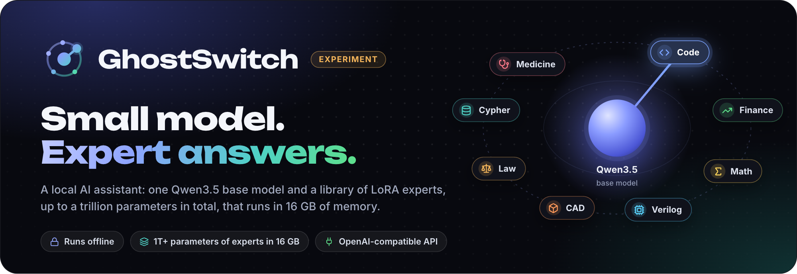
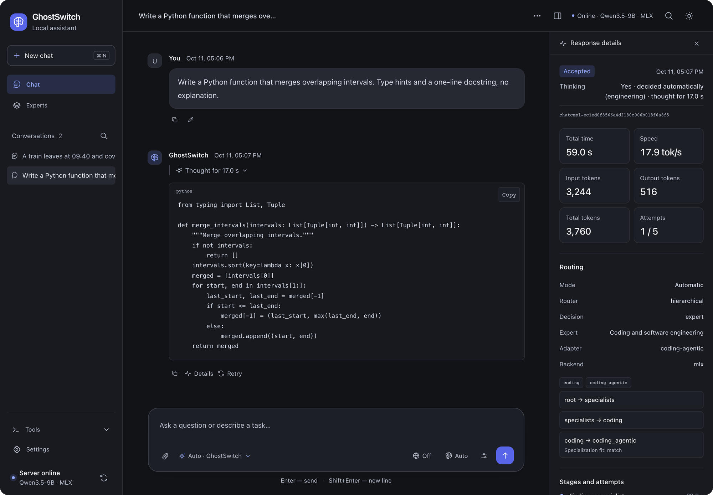
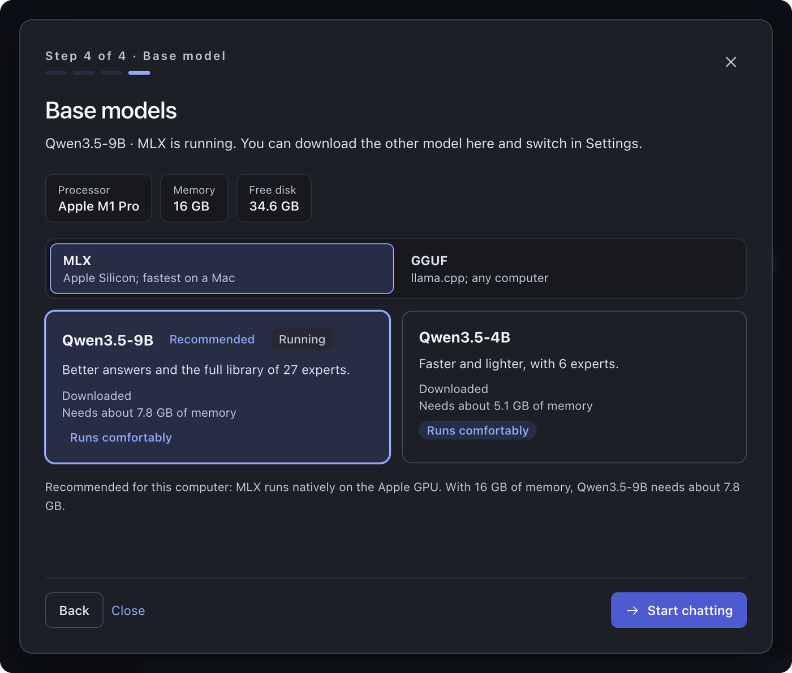
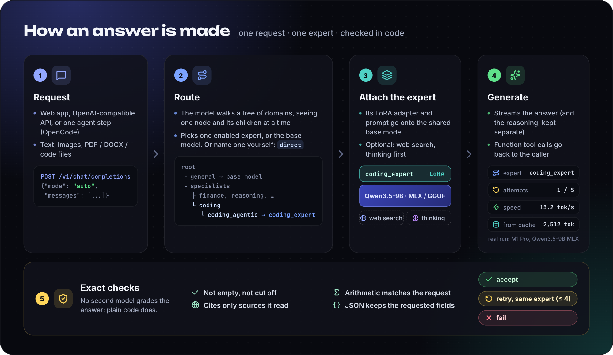
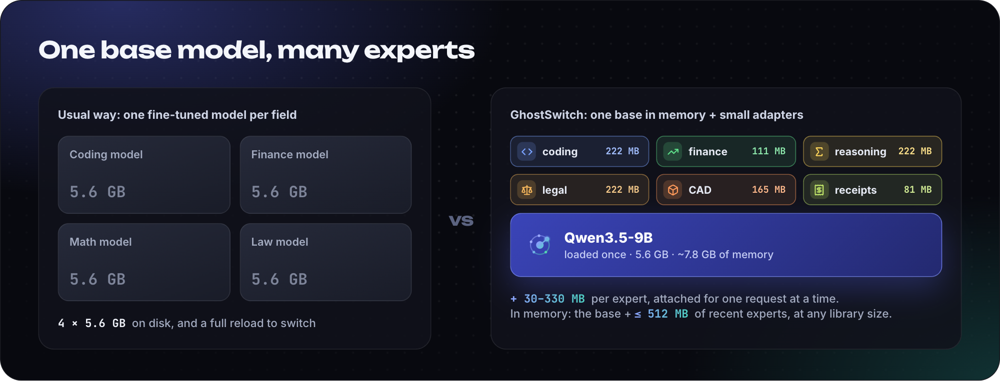
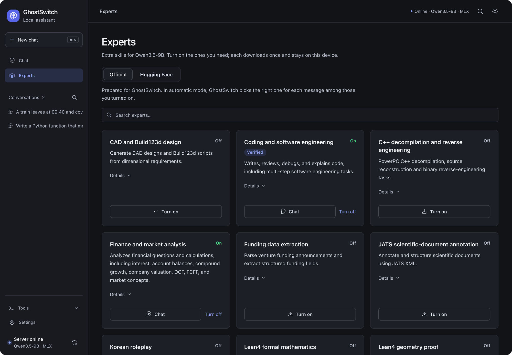
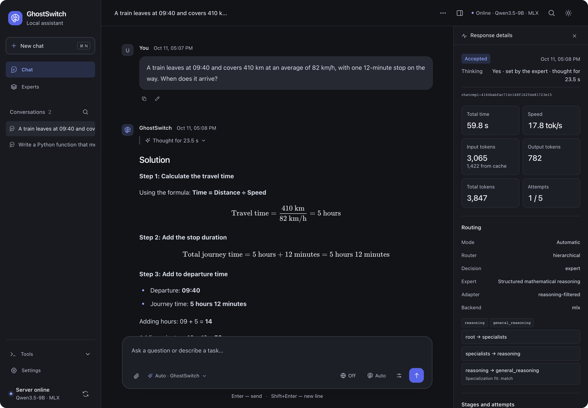

<p align="center">
  
</p>

<p align="center">
  
  <a href="LICENSE"></a>
  
  
  
  
  <a href="https://github.com/hiddenway/ghostswitch/actions/workflows/installer.yml"></a>
</p>

<p align="center">
  <a href="#quick-start"><b>Quick start</b></a> ·
  <a href="#how-it-works"><b>How it works</b></a> ·
  <a href="#experts"><b>Experts</b></a> ·
  <a href="#use-it-from-code"><b>API</b></a> ·
  <a href="docs/reference.md"><b>Reference</b></a>
</p>

**GhostSwitch** is an AI assistant that runs entirely on your own computer. It loads one open model, **Qwen3.5**, and gives it a library of **experts**: small LoRA add-ons trained for code, finance, math, law, CAD, Verilog and two dozen other fields. For every message GhostSwitch picks the expert that fits, attaches it to the model that is already in memory, writes the answer and checks it in code before you see it.

Because only one expert is attached at a time, the library can grow to thousands of experts, a trillion parameters and more in total, and GhostSwitch still runs on a laptop with 16 GB of memory.

You get a chat app in the browser and an OpenAI-compatible API for your scripts and coding agents.

> [!WARNING]
> **GhostSwitch is an experiment.** It tests whether one small local model with a library of LoRA experts can give expert-quality answers, and that question is still open: so far one expert is measurably better than the base model, routing is slow and sometimes picks the wrong expert, and the API, settings and expert format may change without notice. Try it, measure it, tell us what you find, but do not rely on its answers for medical, legal, financial or security decisions.

<p align="center">
  
  <br>
  <sub>A coding question routed to <code>coding_expert</code>. Every answer shows its route through the expert tree, speed, tokens and checks.</sub>
</p>

## Why GhostSwitch

- **A library of any size, in 16 GB.** GhostSwitch keeps one base model in memory and attaches a 30–330 MB expert only for the request that needs it; experts you have not used lately are not kept in memory. A thousand experts need the same memory as one: the base model plus at most 512 MB of recently used adapters. A dedicated fine-tuned model per field would need gigabytes per field and a reload for every switch.
- **You don't pick the expert.** A router reads the message and chooses among the experts you turned on, or answers with the plain base model when none fits. You can still name one yourself.
- **Answers are checked by code, not by another model.** Is the answer complete? Does the arithmetic match the numbers in the question? Does it cite only pages it actually read? Does the JSON keep the requested fields? If a check fails, the same expert writes the answer again, up to four more times.
- **Experts have to prove themselves.** Each expert can be measured against the bare base model on a public benchmark. Those that are no better are blocked and never routed to. So far one has earned **Verified**: [see the results](#measured-not-assumed).
- **Private by default.** Chats stay on your computer. GhostSwitch goes online only to download models and experts from Hugging Face, and to search the web when you turn search on.
- **Fits your tools.** `/v1/chat/completions` with streaming, function tools, images and files. Works with the OpenAI SDKs and as a model for the [OpenCode](integrations/opencode/README.md) coding agent.
- **Thinks when it helps.** Math, logic, planning and programming tasks get step-by-step reasoning first; small edits, facts and chat are answered right away. One click forces it either way.

## Quick start

One command installs GhostSwitch and opens it in your browser. It brings its own Python and needs no administrator rights.

**macOS** (Apple Silicon) and **Linux**, in Terminal:

```bash
curl -fsSL https://raw.githubusercontent.com/hiddenway/ghostswitch/main/install.sh | sh
```

**Windows** 10 or 11, in PowerShell:

```powershell
irm https://raw.githubusercontent.com/hiddenway/ghostswitch/main/install.ps1 | iex
```

The app opens at **http://127.0.0.1:27246/app/**. On the first run it looks at your processor, memory, GPU and free disk, recommends a base model and downloads it. Then it fetches the default experts in the background (coding, reasoning and finance for the 9B model) and you can start chatting right away.

<p align="center">
  
</p>

Afterwards:

| Command | What it does |
|---|---|
| `ghostswitch` | Start GhostSwitch and open the app. Ctrl+C or closing the window stops it. |
| `ghostswitch --port 8080` | Use another port. By default it takes 27246, or the next free one. |
| `ghostswitch update` | Install the latest release. Models, experts and settings are kept. |
| `ghostswitch doctor` | Show what is installed and what to fix. |
| `ghostswitch uninstall` | Remove GhostSwitch; it asks whether to keep the downloaded models. |

### What you need

| | Runs on | Not supported |
|---|---|---|
| **macOS** 14+ | Apple Silicon (M1 or newer), MLX on the GPU | Intel Macs |
| **Linux** x86_64 or ARM64 | llama.cpp with CUDA on an NVIDIA GPU (CUDA 12 driver, glibc 2.35+), otherwise on the processor | |
| **Windows** 10/11, 64-bit | llama.cpp with CUDA on an NVIDIA GPU, otherwise on the processor | Windows on ARM |

| Base model | Download | Memory | Experts | Choose it when |
|---|---|---|---|---|
| **Qwen3.5-9B** (default) | 6.0 GB (MLX) · 5.6 GB (GGUF) | ~7.8 GB (MLX) · ~6.7 GB (GGUF) | 27 | you have 16 GB of memory or more |
| **Qwen3.5-4B** | 3.0 GB (MLX) · 2.7 GB (GGUF) | ~5.1 GB (MLX) · ~4.0 GB (GGUF) | 6 | you have 8 GB, or want faster answers |

You can switch the model or backend later in **Settings → Base model**. A processor without a GPU works, but slowly: there GhostSwitch does not think before answering unless you ask it to.

## How it works

<p align="center">
  
</p>

1. **Route.** Short model calls walk a tree of domains: first *general question* or *specialist work*, then the field (finance, coding, reasoning, legal, engineering design, …), then the expert. At each step the model sees only the current node and its children, so every decision is small and focused. It answers with the experts you turned on; when a catalog expert you have not turned on fits better, the app offers to download it.
2. **Attach.** The expert's LoRA adapter and its instructions go onto the base model that is already loaded. There is no model reload; the adapter costs about 0.1–0.3 s per answer.
3. **Generate.** Optionally GhostSwitch searches the web first (DuckDuckGo, Brave or your own SearXNG) and cites the pages as `[1]`, `[2]`. Optionally it reasons step by step; the reasoning is returned separately from the answer.
4. **Check.** Plain code checks the answer and either accepts it, asks the same expert for a new one, or reports a failure. We tried a second model as a reviewer: it made answers about 42% slower and no more accurate ([audit, in Russian](docs/verifier-audit.ru.md)).

Every request runs in one of three modes:

| Mode | Who picks the expert |
|---|---|
| `auto` (default) | The router, among the experts you turned on, or the base model |
| `direct` | You: `"expert_id": "coding_expert"` |
| `base` | Nobody: the plain base model answers |

GhostSwitch answers **one step at a time** and stays out of your workflow: plans, memory, tool loops and chains of experts belong to the app that calls it, such as a coding agent. That keeps it predictable as a drop-in model.

<p align="center">
  
</p>

A [LoRA](https://arxiv.org/abs/2106.09685) adapter is a small set of extra weights trained on top of a base model. Because every expert was trained for the same base model, GhostSwitch can keep that model in memory once and switch skills by swapping adapters, on a laptop with 16 GB.

That is why the size of the library does not matter for memory. A 222 MB adapter holds about 110 million parameters, so a library of 9,000 such experts adds up to a trillion parameters, yet each answer needs only the base model and one of them. Recently used adapters stay in memory so that switching back is instant, within a 512 MB budget; older ones are dropped and loaded again from disk in under a second when needed. Measured on an M1 Pro with the 9B model: using six different experts in a row adds 1.2 GB to the server without the budget, and about 0.6 GB with it, however many experts follow. Two things do grow with the library: the disk space of the experts you turn on, and the choice the router has to make. And a large library is breadth, not size: every answer still comes from Qwen3.5 with one expert attached.

## Experts

Experts are LoRA adapters that people publish on Hugging Face, packaged for GhostSwitch with a description, a place in the routing tree, instructions and a pinned revision. Open **Experts** in the app, turn on the ones you need, and each downloads once. The **Hugging Face** tab finds any other adapter made for your base model; those are not checked by GhostSwitch, so you pick them by hand for a chat and the router never uses them.

<p align="center">
  
</p>

### Measured, not assumed

An adapter that sounds good on its model card does not always beat the model it was trained on. In October 2026 we asked 13 of the 9B experts 60 questions each from a public benchmark of their field, and asked the bare base model the same questions (Qwen3.5-9B Q4_K_M, verifier and thinking off). Only differences that hold up in a paired test count.

| Result | Experts |
|---|---|
| ✅ **Verified**: better than the base model (p < 0.05) | `coding_expert`: HumanEval+ **88.3%** vs 76.7% |
| ↗ **Leaning better**: needs a larger run | `legal_contract_expert`: LegalBench CUAD 83.3% vs 76.7% · `privacy_dlp_expert`: PII F1 78.3% vs 75.3% |
| ⏳ **Undecided** | `reasoning_expert`: GSM8K 90.0% vs 88.3%, measured without thinking · `finance_market_expert`: FinQA 66.7% vs 61.7% · `software_engineering_expert`: HumanEval+ 81.7% vs 76.7% |
| ⛔ **Blocked**: no better than the base model | `cybersecurity_expert` (worse: 51.7% vs 56.7%), `coding_delta_expert`, `text_to_sql_expert`, `medical_reasoning_expert`, `penetration_testing_expert`, `iac_security_expert`, `entity_extraction_expert` |
| **Not measured yet** | 14 experts that need a judge or tools to grade: Verilog, OpenSCAD, Lean4, CAD, decompilation, roleplay and others |

Blocked experts stay in the catalog with the reason on their card and can still be called with `"mode": "direct"`, so anyone can measure them again. Every number, and why each expert was blocked, is in [docs/expert-blocklist.ru.md](docs/expert-blocklist.ru.md) (in Russian); the script is `scripts/expert_eval.py`.

<details>
<summary><b>The full expert catalog</b></summary>
<br>

**Qwen3.5-9B** (27 experts)

| Expert | Field | LoRA on Hugging Face | Status |
|---|---|---|---|
| `cad_design_expert` | CAD and Build123d design | [gaurav-tyagi/cadmium-cad-grpo-9b](https://huggingface.co/gaurav-tyagi/cadmium-cad-grpo-9b) | — |
| `coding_delta_expert` | DeltaCoder coding agent | [danielcherubini/Qwen3.5-DeltaCoder-9B](https://huggingface.co/danielcherubini/Qwen3.5-DeltaCoder-9B) | ⛔ blocked |
| `coding_expert` | Coding and software engineering | [blackshell69/Qwen3.5-9B-distilled-coding-agentic](https://huggingface.co/blackshell69/Qwen3.5-9B-distilled-coding-agentic) | ✅ verified · on by default |
| `cybersecurity_expert` | Cybersecurity and vulnerability analysis | [Muneerali199/rakshak-cwe-v2](https://huggingface.co/Muneerali199/rakshak-cwe-v2) | ⛔ blocked |
| `decompilation_expert` | C++ decompilation and reverse engineering | [freeqaz/decomp-synth-lifter-v17-mix-qwen3.5-9b-lora](https://huggingface.co/freeqaz/decomp-synth-lifter-v17-mix-qwen3.5-9b-lora) | — |
| `entity_extraction_expert` | Entity extraction | [illuminator22/openbrief-nano-qwen35-entity-extractor](https://huggingface.co/illuminator22/openbrief-nano-qwen35-entity-extractor) | ⛔ blocked |
| `finance_market_expert` | Finance and market analysis | [ZaoKing/khudi-finance-v0-3-arithmetic-candidate](https://huggingface.co/ZaoKing/khudi-finance-v0-3-arithmetic-candidate) | ⏳ undecided · on by default |
| `funding_data_expert` | Funding data extraction | [cometadata/funding-parsing-lora-Qwen3.5_9B-ep2-r16-a32-distill-GLM_4.5_Air](https://huggingface.co/cometadata/funding-parsing-lora-Qwen3.5_9B-ep2-r16-a32-distill-GLM_4.5_Air) | — |
| `iac_security_expert` | Infrastructure-as-code security | [selcuksntrk/iac-secfix-qwen35-9b-lora](https://huggingface.co/selcuksntrk/iac-secfix-qwen35-9b-lora) | ⛔ blocked |
| `jats_annotation_expert` | JATS scientific-document annotation | [public-knowledge-project/agentic-jats-annotation-qwen3.5-9b-lora-v8-rl-step70](https://huggingface.co/public-knowledge-project/agentic-jats-annotation-qwen3.5-9b-lora-v8-rl-step70) | — |
| `korean_roleplay_expert` | Korean roleplay | [www622846/qwen3.5-9b-rp-lora-v2](https://huggingface.co/www622846/qwen3.5-9b-rp-lora-v2) | — |
| `lean4_generalist_expert` | Lean4 formal mathematics | [connorolson/qwen35-9b-lean4-generalist-lora](https://huggingface.co/connorolson/qwen35-9b-lean4-generalist-lora) | — |
| `lean4_geometry_expert` | Lean4 geometry proof | [connorolson/qwen35-9b-lean4-geometry-lora](https://huggingface.co/connorolson/qwen35-9b-lean4-geometry-lora) | — |
| `legal_contract_expert` | Legal contract analysis | [ximilala/qwen35-9b-legal-lora](https://huggingface.co/ximilala/qwen35-9b-legal-lora) | ↗ leaning better |
| `medical_reasoning_expert` | Medical question reasoning | [jamezoon/qwen3-5-9b-medmcqa-lora](https://huggingface.co/jamezoon/qwen3-5-9b-medmcqa-lora) | ⛔ blocked |
| `openscad_expert` | OpenSCAD model generation | [Max2475/qwen3.5-9b-openscad-lora](https://huggingface.co/Max2475/qwen3.5-9b-openscad-lora) | — |
| `penetration_testing_expert` | Penetration testing | [HRB25/qwen35-9b-pentest-v5](https://huggingface.co/HRB25/qwen35-9b-pentest-v5) | ⛔ blocked |
| `privacy_dlp_expert` | PII detection and data loss prevention | [querypieai/qwen3.5-9b-dlp-pii-lora](https://huggingface.co/querypieai/qwen3.5-9b-dlp-pii-lora) | ↗ leaning better |
| `reasoning_expert` | Structured mathematical reasoning | [cudabenchmarktest/qwen3.5-9b-qwen3.6-reasoning-distilled](https://huggingface.co/cudabenchmarktest/qwen3.5-9b-qwen3.6-reasoning-distilled) | ⏳ undecided · on by default |
| `roleplay_expert` | Roleplay dialogue | [ChatoyantAI/qwen3.5-9b-roleplay-sft-original50k-epoch1-lora](https://huggingface.co/ChatoyantAI/qwen3.5-9b-roleplay-sft-original50k-epoch1-lora) | — |
| `software_engineering_expert` | SWE-Gym software engineering | [Shreyansh327/qwen3.5-9b-swegym-lora-full](https://huggingface.co/Shreyansh327/qwen3.5-9b-swegym-lora-full) | ⏳ undecided |
| `spanish_legal_expert` | Spanish legal analysis | [Abogatic/qwen35-9b-legal-sft-es-v1](https://huggingface.co/Abogatic/qwen35-9b-legal-sft-es-v1) | — |
| `stablecoin_finance_expert` | Stablecoin and crypto finance | [ximilala/qwen35-stablecoin-round3-lora](https://huggingface.co/ximilala/qwen35-stablecoin-round3-lora) | — |
| `text_to_cypher_expert` | Text-to-Cypher generation | [danp27/qwen3.5-9b-nl2cypher-lora](https://huggingface.co/danp27/qwen3.5-9b-nl2cypher-lora) | — |
| `text_to_sql_expert` | Text-to-SQL generation | [whileai/text-to-sql-shop-qwen3.5-9b-r1-step75](https://huggingface.co/whileai/text-to-sql-shop-qwen3.5-9b-r1-step75) | ⛔ blocked |
| `traffic_law_expert` | Vietnamese traffic law and regulation | [Anakonkai/qwen3.5-9b-lora-traffic-rag-sft-v2](https://huggingface.co/Anakonkai/qwen3.5-9b-lora-traffic-rag-sft-v2) | — |
| `verilog_expert` | Verilog and RTL design | [Pablo-Flores-Mollinedo/verilog-qwen3.5-9b-v33-thinking-reinforced-lora](https://huggingface.co/Pablo-Flores-Mollinedo/verilog-qwen3.5-9b-v33-thinking-reinforced-lora) | — |

**Qwen3.5-4B** (6 experts)

| Expert | Field | LoRA on Hugging Face | Status |
|---|---|---|---|
| `finance_market_expert` | Finance and market analysis | [alinakhay/FinVector-Market-4B](https://huggingface.co/alinakhay/FinVector-Market-4B) | — |
| `legal_trademark_expert` | Trademark distinctiveness classification | [DoodDood/abercrombie-grpo](https://huggingface.co/DoodDood/abercrombie-grpo) | — |
| `linux_shell_expert` | Linux shell commands | [louisguthmann/qwen3.5-4b-shellcommand-linux-lora](https://huggingface.co/louisguthmann/qwen3.5-4b-shellcommand-linux-lora) | — |
| `medical_reasoning_expert` | Medical question reasoning | [naazimsnh02/Shifa-4B-SFT-LoRA](https://huggingface.co/naazimsnh02/Shifa-4B-SFT-LoRA) | — |
| `receipt_extraction_expert` | Receipt and invoice extraction | [singhabhishekkk/apprentice-qwen35-4b-lora-receipts](https://huggingface.co/singhabhishekkk/apprentice-qwen35-4b-lora-receipts) | on by default |
| `translation_en_kn_expert` | Kannada translation and writing | [kshitijdesai99/Qwen-3.5-4B-finetuned_mt-nllb-en-kn](https://huggingface.co/kshitijdesai99/Qwen-3.5-4B-finetuned_mt-nllb-en-kn) | — |

Thanks to the authors of these adapters: GhostSwitch only packages and routes their work. Each expert's folder in [`experts/`](experts/) has a README with its source, license, scope and limits.

</details>

### Add your own expert

An expert is a folder of small text files. The weights stay on Hugging Face; Git stores only a reference pinned to a commit.

```text
experts/qwen35-9b/my_expert/
├── expert.json      # id, name, description, keywords, place in the routing tree
├── lora.json        # Hugging Face repository + pinned 40-character revision
├── prompt.txt       # instructions for the model while this expert is attached
└── README.md        # source, license, scope, examples, limitations
```

Copy [`experts/_template`](experts/_template), fill it in, check it with `python scripts/validate_experts.py` and open a pull request. On the next start the expert joins the catalog and the routing tree by itself; no global list needs editing. The [package standard](experts/README.md) covers every field, and a measurement with `scripts/expert_eval.py` is how an expert becomes **Verified**.

## Use it from code

The installed app serves an OpenAI-compatible API at `http://127.0.0.1:27246/v1`. No API key is checked.

```bash
curl http://127.0.0.1:27246/v1/chat/completions \
  -H 'Content-Type: application/json' \
  -d '{"model": "ghostswitch-v6", "mode": "auto",
       "messages": [{"role": "user", "content": "Write a bash one-liner that counts lines in all .py files"}]}'
```

With the OpenAI Python SDK, GhostSwitch's own options go in `extra_body`:

```python
from openai import OpenAI

client = OpenAI(base_url="http://127.0.0.1:27246/v1", api_key="local")

reply = client.chat.completions.create(
    model="ghostswitch-v6",
    messages=[{"role": "user", "content": "Write a bash one-liner that counts lines in all .py files"}],
    extra_body={"mode": "direct", "expert_id": "coding_expert"},
)
print(reply.choices[0].message.content)
print(reply.model_extra["ghostswitch"]["verification"])   # {'status': 'ACCEPT', 'attempts': 1}
```

Every response carries an `ghostswitch` field that explains how the answer was made:

```jsonc
"ghostswitch": {
  "mode": "auto",
  "route": "expert",
  "expert_id": "coding_expert",
  "adapter": "coding-agentic",
  "router_confidence": 0.95,
  "verification": {"status": "ACCEPT", "attempts": 1},
  "thinking": {"enabled": false, "source": "request", "used": false},
  "web_search": null,
  "backend": "mlx",
  "router_steps": [ … ],      // each decision in the routing tree, with timing
  "stages": [ … ]             // routing, search, generation, checks, with timing
}
```

| Option | Values |
|---|---|
| `mode` | `auto`, `direct` (with `expert_id`), `base` |
| `stream` | `true` for server-sent events; reasoning arrives first in `delta.reasoning_content` |
| `web_search` | `off` (default), `auto` (search when the question needs current facts), `on` |
| `reasoning_effort` | `none` turns thinking off; `low`, `medium`, `high` turn it on. Without it, GhostSwitch decides |
| `tools`, `tool_choice` | OpenAI function calling; your code runs the tools |
| content parts | `image_url` and `file` as base64 `data:` URLs: images, PDF, DOCX, text and code |

If the router picks an expert that is not downloaded yet, the API answers HTTP 422 with the expert's id and how to enable it (`POST /v1/experts/{id}` with `{"action": "enable"}`), or you can resend with `"mode": "base"`. The [reference](docs/reference.md#run) documents every endpoint, including the expert library, base model switching and search settings.

### With OpenCode

GhostSwitch works as the model of the [OpenCode](https://opencode.ai) coding agent: OpenCode runs the files, shell and tools, GhostSwitch picks an expert for each step. Merge [`integrations/opencode/opencode.json`](integrations/opencode/opencode.json) into your OpenCode configuration and run:

```bash
opencode --model ghostswitch/ghostswitch-v6 --agent ghostswitch
```

## The app

<p align="center">
  
  <br>
  <sub>A word problem: GhostSwitch chose the reasoning expert, which always thinks before answering, and rendered the solution with formulas.</sub>
</p>

- **Chats** are saved in your browser, with search, pinning, Markdown export and JSON import/export.
- **Composer switches** for the expert (automatic or a fixed one), web search (off, auto, on) and thinking (auto, on, off).
- **Attachments**: paste, drop or pick images, PDFs, DOCX, text and code files. Images go to the base model's own vision encoder.
- **Details** on every reply: the routing path, expert and adapter, each stage with its timing, every attempt and why it was retried, tokens taken from the prompt cache, and the raw JSON.
- **Tools**: usage statistics, a request log and an API playground with cURL, JavaScript and Python examples.
- **Settings**: base model and backend with each option's memory need, web search provider, theme, generation defaults and a system instruction.

## Configuration

Most settings live in the app. An installed GhostSwitch keeps everything in one folder: `~/.ghostswitch` on macOS and Linux, `%LOCALAPPDATA%\GhostSwitch` on Windows. Updates replace the app and keep its `data` folder with the models, experts, settings and request journal. Run from source, it keeps models in the project folder, settings in `~/.config/ghostswitch` and caches in `~/.cache/ghostswitch`.

A few environment variables cover what the app does not:

| Variable | Default | What it changes |
|---|---|---|
| `GHOSTSWITCH_HOME` | `data` in the install folder | Where models, caches and settings are kept |
| `GHOSTSWITCH_GGUF_CONTEXT` | `32768` | llama.cpp context length, reserved when the model loads |
| `GHOSTSWITCH_MLX_CACHE_MB` | `1024` | MLX buffer cache |
| `GHOSTSWITCH_PROMPT_CACHE_MB` | `256` | Cache for the long fixed instructions repeated in every request |
| `GHOSTSWITCH_HISTORY_CACHE_MB` | `1024` | Model state after an agent's conversation, so its next step computes only the new messages |
| `GHOSTSWITCH_LORA_MEMORY_MB` | `512` | Recently used expert adapters kept in memory on MLX; `0` keeps only the one in use |
| `GHOSTSWITCH_MAX_IMAGES` | `4` | How many of the conversation's latest images the model sees |

The installer has its own options, such as `GHOSTSWITCH_VARIANT=cpu` or `GHOSTSWITCH_NO_START=1`. All of them are in the [reference](docs/reference.md).

## Development

```bash
git clone https://github.com/hiddenway/ghostswitch.git
cd ghostswitch
uv sync --extra mlx            # Apple Silicon; --extra cpu or --extra cuda elsewhere
uv run python -m core.cli      # starts the server and opens the app, like the installed command
```

[uv](https://docs.astral.sh/uv/) installs the exact versions from `uv.lock`. Run the tests with `uv run python -m unittest discover -s core/tests -t .`

| Path | What is there |
|---|---|
| [`core/`](core/) | The runtime: HTTP API (`api.py`), one inference step (`main.py`), router (`router_v6.py`), checks (`verifier_v6.py`), MLX and llama.cpp backends, expert library |
| [`client/`](client/) | The web app: plain HTML, CSS and JavaScript, no build step |
| [`experts/`](experts/) | Expert packages for each base model, and the template |
| [`core_models/`](core_models/) | Base model descriptions with pinned Hugging Face revisions |
| [`scripts/`](scripts/) | Benchmarks, expert evaluation, GGUF adapter conversion, package validation |
| [`docs/`](docs/) | The [reference](docs/reference.md), [GPU benchmarking guide](docs/benchmarking.md) and design notes (in Russian) |

## FAQ

**Is it smarter than plain Qwen3.5?**\
On coding, measurably: the coding expert solves 88% of HumanEval+ against the base model's 77%. In most other fields the experts measured so far match the base model, and those that did not help are blocked. GhostSwitch's job is to use an expert where it helps and step aside where it does not; the [measurements](#measured-not-assumed) show where that stands today.

**Does it work offline?**\
Yes, once the base model and your experts are downloaded. Routing, answers and checks all run locally; only web search and browsing Hugging Face for new adapters need the internet.

**How fast is it?**\
On a MacBook Pro with M1 Pro and 16 GB, the 9B model on MLX writes 13–18 tokens per second. Before the answer, the router makes a few short model calls and the model may think first, so each answer in the screenshots above took about a minute, 17–24 s of it thinking. Turning thinking off for a request, or the 4B model, answers faster.

**Can I use my own LoRA?**\
Yes. Add any adapter made for Qwen3.5-9B or 4B from the **Hugging Face** tab and pick it for a chat, or package it as an expert so the router can choose it.

**What happened to OmniBrain?**\
It is the same project under a new name (and before that it was MiniBrain). Installed copies update in place and keep the `omnibrain` command; old `OMNIBRAIN_*` variables, folders and the `omnibrain-v6` model id keep working. API responses now carry their telemetry in `ghostswitch` instead of `omnibrain`; see [the reference](docs/reference.md#renamed-from-omnibrain-and-minibrain).

## License

GhostSwitch is released under the [Apache License 2.0](LICENSE). The base models and expert adapters are downloaded from Hugging Face and keep their own licenses: check the model card linked from each expert's README before you use it.

Built on [Qwen3.5](https://huggingface.co/Qwen), [MLX](https://github.com/ml-explore/mlx), [llama.cpp](https://github.com/ggml-org/llama.cpp) and the work of every adapter author listed in the [expert catalog](#experts).
